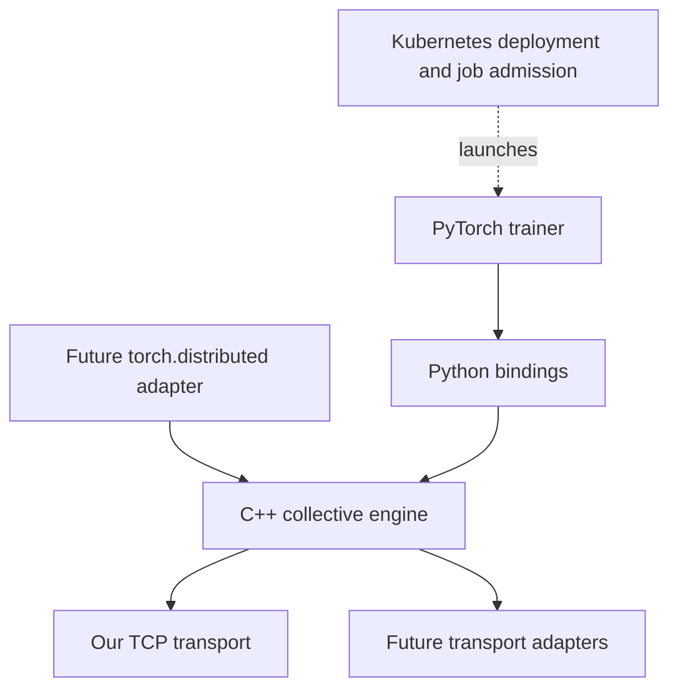

# capsulet-mesh-train

A distributed training communication engine built in C++, with PyTorch integration.

The core project implements its own transport and collective algorithms. GPU training is the main target; a four-process CPU trainer establishes correctness first. Existing communication libraries and training frameworks can attach through adapters.

## Current state

M1 implementation is underway. The standalone C++ core implements blocking centralized FP32 SUM all-reduce over its own Linux TCP transport, with bounded failures and safe cleanup. Native validation covers 1–5 worker processes, exact/random numerical checks, failure scenarios, and four independent containers. The optional Python package exposes strict in-place NumPy buffers with retained ownership and GIL release. The optional PyTorch MLP trainer passes four-worker/100-step parity against an independent combined-batch reference, with explicit gradient averaging and rank diagnostics. Four-container trainer validation remains #8.

This is an open-ended side project. Milestones describe outcomes and dependencies, with no dates or time estimates.

## Start here

- [Roadmap and milestone completion criteria](docs/ROADMAP.md)
- [Build instructions and verified environments](docs/DEVELOPMENT.md)
- [Python package, API and focused verification](docs/PYTHON.md)
- [Run the CPU trainer and inspect numerical evidence](docs/TRAINING.md)
- [Reproduce native failures and four-container M1 validation](docs/VALIDATION.md)
- [CPU MVP design](docs/superpowers/specs/2026-10-16-cpu-mvp-design.md)
- [Decisions and their rationale](docs/DECISIONS.md)
- [Architecture decision records](docs/adr/README.md)
- [GitHub work index](docs/ISSUES.md)
- [Contributor and agent navigation](AGENTS.md)
- [Repository OpenSpec workflow and skills](AGENTS.md#task-workflow-and-local-skills)
- [Primary references](docs/REFERENCES.md)

## First training target

Four independent CPU processes consume different minibatches, compute gradients with PyTorch, and synchronize them through our native C++ centralized all-reduce. Their losses, averaged gradients, and updated parameters must match a single-process reference using the same combined batches within specified numerical tolerances.

The engine owns socket communication and reduction. PyTorch owns the model, autograd, and initial optimizer. Gloo, MPI, and NCCL are reference implementations or explicit adapters; benchmark baselines remain separate from our collective implementations.

## Architecture

The standalone C++ library does not require PyTorch, Python, Kubernetes, or CUDA to build. CUDA and framework integrations are optional layers.

## Development and validation direction

Linux is the primary runtime. Development can use Ubuntu under WSL2; Linux containers provide a reproducible deployment environment. Native Windows support has its own milestone.

The currently available machine has one NVIDIA RTX 5070 Ti Laptop GPU with approximately 12 GB VRAM. This permits CUDA integration tests. Shared-GPU tests and local containers do not establish multi-GPU or physical multi-host scaling; those results have a separate hardware-dependent milestone.

Later work covers ring and tree collectives, GPU transfers and overlap, reduce-scatter/all-gather, sharded Adam states, checkpoint recovery, Kubernetes deployment with exclusive job-token pools, external transports, and a PyTorch communication backend.
