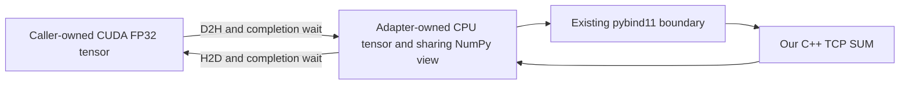

# Design: Explicit host-staged CUDA tensor adapter

Read [proposal.md](proposal.md) for scope/authorization and [tasks.md](tasks.md) for verification steps. Preserve [ADR 0001](../../adr/0001-blocking-centralized-fp32-communicator.md), [ADR 0002](../../adr/0002-python-buffer-ownership.md) and the CPU training contract in [ADR 0003](../../adr/0003-replicated-sgd-training-contract.md). [Accepted ADR 0004](../../adr/0004-blocking-host-staged-cuda-adapter.md) adds the reviewed, owner-authorized CUDA integration boundary without superseding those records.

## Approach and boundaries

Use PyTorch's Python tensor/copy APIs around the existing strict NumPy binding. The C++ core continues to receive only valid host FP32 spans and performs every collective operation itself. No CUDA header, runtime library, tensor type or stream handle crosses that core interface. This is an optional integration module, not a PyTorch communication backend.



Proposed files, not existing commands or implementation:

| Area | Responsibility |
| --- | --- |
| `python/meshtrain/cuda_adapter.py` | Strict CUDA tensor contract, retained workspace, stream completion and timing record. |
| `tests/cuda/` | Focused installed-package GPU workers, real communication and lifecycle/stream checks. |
| `tools/check_cuda_adapter.py` | Fresh sdist/wheel/runtime, hardware preflight, bounded worker execution and evidence. |
| `requirements/training-cuda.in` / `.lock` | Separate exact CUDA-enabled PyTorch runtime and hash-locked dependencies. |
| `docs/CUDA.md` and this task | Reproduction, supported environment, raw measurements and limits. |
| `docs/adr/0004-blocking-host-staged-cuda-adapter.md` | Durable adapter contract, Proposed until accepted. |

Do not change `meshtrain.__init__` to import PyTorch or initialize CUDA. Explicitly importing the optional adapter may import Torch; constructing a workspace performs the CUDA-availability/device checks. The base package, current CPU adapter and trainer retain their behavior. Ordinary new comments/docstrings remain at most two physical lines; design rationale belongs here.

## API and validation

Proposed public API:

```python
from meshtrain.cuda_adapter import CudaStagingAdapter

adapter = CudaStagingAdapter(
    count=1025, device="cuda:0", pin_memory=True,
    max_staging_bytes=268435456,
)
timing = adapter.all_reduce_sum_(tensor, communicator)
```

The adapter owns one fixed-count, one-dimensional CPU `torch.float32` staging tensor and its detached sharing NumPy view. Create that workspace inside `torch.inference_mode(False)`, so construction under a caller's inference context still produces ordinary mutable storage; restore the caller's mode on exit. `communicator` is an ordinary existing `meshtrain.Communicator`, excluding subclasses/overridden collective methods; the caller owns its normal construction/close lifecycle, and the method retains it during use. Construction does not join a group. There is no public workspace mutation API, resize, asynchronous handle or adapter-owned progress thread.

- `count` and `max_staging_bytes` are ordinary integers, excluding booleans. Count is nonnegative; the byte limit is nonnegative and representable. Validate `4 * count` against representability and this allocation budget before allocation. The default budget is 256 MiB; a caller may explicitly select another representable budget. This is a workspace bound, not a duplicate of the native communicator's independent admitted payload-limit policy.
- `device` must resolve to an explicit indexed CUDA device, such as `cuda:0`; reject unindexed `cuda`, CPU/meta/other accelerators, invalid/out-of-range indices and unavailable CUDA. Record logical index and observed physical identity. `CUDA_VISIBLE_DEVICES` may remap indices; the adapter does not assign devices or change a caller's persistent current-device/stream settings.
- `pin_memory` must be a bool. Allocate nonempty pinned storage when requested and check its actual property. Failure to allocate/pin raises the original framework/allocation error; there is no fallback. Pageable mode requests ordinary CPU storage. Empty input needs no pinned backing pages and is reported separately.
- Accept an ordinary `torch.Tensor`, excluding tensor subclasses/Parameters and foreign dispatch/fake tensor objects. Require the configured CUDA device, `torch.float32`, strided dense storage, exactly one dimension, matching element count, contiguity, no conjugate/negative view bit, and `requires_grad=False`. Also reject `torch.is_inference(tensor)` and an active forward tangent before any copy or native admission. Inspect `torch.autograd.forward_ad.unpack_dual(tensor).tangent` inside `torch.inference_mode(False)` and restore caller mode, because inference mode otherwise hides an existing tangent. `no_grad` alone does not establish this contract. Contiguous subviews with a storage offset are allowed; preserve the caller's allocation and surrounding storage. Reject rather than casting, flattening, detaching or repacking unsuitable input.
- Reject CUDA graph capture and unsupported argument kinds explicitly. This is an eager, blocking buffer operation, not an autograd operator. It preserves the core's SUM semantics, including special FP32 values; gradient finiteness checks and division by world size belong to the training layer in #11.

Return a frozen `CudaReductionTiming` value containing `count`, `bytes`, configured logical device, requested memory mode and the five millisecond fields below. Success mutates the original GPU allocation; returning timings does not transfer storage ownership. Keep this module's typing local, without adding an eager Torch dependency to the base stubs/import.

## Stream and data flow contract

Capture `torch.cuda.current_stream(configured_device)` for the call and perform GPU copies in that device/stream context. Restore the caller's contexts on exit. All producer work, allocation reuse dependencies and alias access must already be on this stream or explicitly ordered before it by the caller. For example, a side-stream producer must be followed by `consumer.wait_stream(producer)` before calling inside the consumer context. The adapter cannot discover unordered writers on arbitrary streams.

PyTorch documents that different streams need explicit ordering and that asynchronous copies need deliberate completion. These facts motivate the following stronger blocking contract; they do not imply automatic cross-stream dependency discovery. See [CUDA semantics](https://docs.pytorch.org/docs/stable/notes/cuda) and [copy_](https://docs.pytorch.org/docs/2.14/generated/torch.Tensor.copy_.html).

For a nonempty accepted input:

1. Acquire the adapter's nonblocking operation guard and retain strong references to the input, workspace/view, communicator and captured stream. Validate before touching input/entering the collective. A second call on the same adapter is rejected without changing the active call.
2. Synchronize that stream to complete its ordered producers. This intentional readiness wait simplifies ownership and distinguishes producer delay from transfer measurements. Do not synchronize every stream/device globally.
3. Copy GPU tensor to the CPU staging tensor. Pinned mode may submit with `non_blocking=True`; pageable mode uses `non_blocking=False`. Synchronize the captured stream before any NumPy/native CPU read, regardless of the submission mode.
4. Call `communicator.all_reduce_sum(sharing_numpy_view)` once. The existing binding retains the export and releases the GIL during native work. No CUDA pointer is passed to C++, and no other collective implementation is called.
5. Only after native success, copy the reduced CPU staging tensor into the same input GPU tensor on the captured stream. Synchronize that stream before reporting success, releasing transient owners or allowing workspace reuse.
6. Release the operation guard and return the timing record. The completed result can now be consumed on another stream; the caller still prevents new concurrent alias writes during the call.

For count zero, validate the CUDA tensor and capture restrictions, perform exactly one native empty collective, and report zero transfer bytes/times. No payload copy/pinning requirement is manufactured. Empty participation still advances native sequence on success.

The adapter retains input storage through the final successful stream wait. It does not rely on Python scope ending immediately after enqueue or on `non_blocking=False` as a universal cross-stream guarantee. Since it completes all of its own stream work before releasing those owners on success, it does not need a later asynchronous allocator-lifetime protocol. Broader `record_stream`/background lifetime policy belongs with future asynchronous work; [PyTorch's record_stream contract](https://docs.pytorch.org/docs/stable/generated/torch.Tensor.record_stream.html) explains that distinction.

## Ownership, errors and failure limits

The caller prevents access through aliases, resizing, storage invalidation, device changes and out-of-band use of the communicator for the duration of the operation. An adapter guard protects its workspace, not all application tensors or every other adapter sharing a communicator. Native collective serialization remains authoritative; do not reproduce native sequence/state/deadline machinery in Python.

| Failure | Required behavior |
| --- | --- |
| Bad arguments, capture mode or adapter already active | Raise before copy/native admission; preserve input and local native sequence. Peers may already be waiting, so the caller aborts the job rather than assuming rollback. |
| Reuse of an adapter poisoned by CUDA execution/interruption | Reject before copy/native admission. A failed operation is never retried on that workspace. |
| Constructor allocation/device failure | Preserve the original framework error; no group has been created/borrowed by this adapter. |
| Native `EngineError` | Propagate category/context unchanged, skip H2D and retain the input GPU values. Native admitted failures are already terminal. Concurrent-call rejection retains the existing active call; do not close it as a generic error-handler side effect. |
| CUDA runtime/copy/completion failure or interruption during staging | Never report success or continue to an optimizer step. Poison the adapter, close the supplied communicator to abort peers, then attempt to settle its captured-stream work, preserving the original error and recording any secondary cleanup errors. No workspace reuse or retry. |
| H2D failure after native success | Native sequence may already have advanced. The GPU result may be partial; abort the group. Do not rewind sequence or claim a group transaction. |

If settling CUDA work fails or hangs, device/host storage safety cannot be certified by a completed native close. Retain the adapter's workspace/failed-operation references while it remains alive, mark cleanup incomplete and require worker termination through the external harness. Do not manually free or recycle an uncertain in-flight allocation. CUDA context/process teardown is a separate outcome from native resource cleanup, not a claim of automatic hardware recovery. The application must stop that worker instead of destroying a failed workspace and continuing CUDA work.

The one-second/five-second M1 bounds cover controlled native scenarios, not CUDA initialization, context scheduling, stream synchronization or a hung GPU driver. No CUDA deadline/cancellation guarantee is added. The GPU check controller owns fresh processes, records PIDs and has an independent 45-second case watchdog, including imports/initialization and cleanup; terminate/reap only its workers on failure. Record unknown cleanup if OS/GPU termination itself cannot be completed. No automatic retry converts a failed case into a pass.

## Timing contract

Use one monotonic host clock, with milliseconds derived from nanoseconds:

| Field | Boundary |
| --- | --- |
| `ready_wait_ms` | Captured-stream producer/readiness synchronization. |
| `d2h_ms` | Copy submission through completed D2H stream wait. |
| `native_ms` | Existing Python binding/native call entry through return; includes binding, waits, TCP and CPU reduction. |
| `h2d_ms` | Copy submission through completed H2D stream wait. |
| `total_ms` | Method entry through completed result, including validation/control overhead. |

For nonempty calls the measured total contains the phase intervals; allow clock representation rounding, not negative/invented durations. Failed calls do not fabricate successful timing records; preserve failed-phase/wall observations in worker evidence. CUDA-event microbenchmarks are optional future instrumentation, not necessary to make these synchronized wall intervals meaningful.

Collect five warmup calls, then ten measured calls for 1025 and 1048576 FP32 elements, for each pinned/pageable mode and one/two workers. Reinitialize the same rank-specific inputs for every call, including warmups, rather than repeatedly reducing the previous result. Save every rank's samples and summarize stage medians/ranges. Warmup is excluded explicitly, allocations are outside steady-state samples, and both modes use the same payload/rank/stream/completion rules. This is a small staging-cost characterization, without a speedup threshold, bandwidth-model fit, Gloo/NCCL comparison or physical-topology claim.

## Runtime and verification environment

Target Linux/WSL x86-64 CPython 3.12, NumPy 2.5.4 and official PyTorch `2.14.1+cu132`, separately locked from CPU `2.14.1+cpu`. The [official CUDA 13.2 wheel index](https://download.pytorch.org/whl/cu132/torch/) lists a CPython 3.12 Linux x86-64 wheel. Its presence is not proof that kernels execute on this GPU; verify the installed runtime and actual device work during implementation. Choose exact URLs/hashes for the runtime and all resolved dependencies, without upgrading CPU/build locks.

CUDA 13.2 is selected over an older CUDA binary variant after the [PyTorch packaging announcement](https://dev-discuss.pytorch.org/t/removing-cuda-13-0-builds-from-pytorch-ci-cd-starting-the-week-of-sept-28/3447) identified a compiler correctness fix in 13.2.2. Record the actual packaged runtime/compiler component versions rather than inferring every component from the `cu132` suffix. If the selected build cannot execute supported operations, record the failure and revise the runtime choice explicitly; never silently install a CPU wheel or mutate the Windows driver.

The [read-only preflight](preflight.md) found one RTX 5070 Ti Laptop GPU, 12227 MiB, exposed to WSL2, with Windows KMD 616.87. The existing training environment is CPU-only. There is no CUDA-enabled PyTorch execution proof yet. A binary PyTorch integration needs no new `nvcc` compilation in our C++ build. Do not install Linux NVIDIA display drivers in WSL; [NVIDIA's WSL guide](https://docs.nvidia.com/cuda/wsl-user-guide/index.html) describes the Windows-driver boundary.

The planned command, once implemented and authorized, is:

```sh
build/toolchain-venv/bin/python tools/check_cuda_adapter.py --output build/cuda-adapter-check
```

It requires the existing locked CPython 3.12 build toolchain, Linux/WSL GPU access and enough disk for a fresh isolated CUDA runtime. Build an sdist-derived wheel, install it and hash-locked runtime dependencies into a fresh environment, then execute installed code with `-I` from outside the source tree. Preserve command logs, source/revision/lock/wheel hashes, import paths, preflight, raw numerical/timing records, errors and child cleanup statuses. Reject stale/nonempty output. Downloads may use hash-checked caches; this is not a cold/offline-machine claim.

No Docker GPU pass-through claim is needed to close #10; WSL hardware execution is the primary local route. Keep existing push/PR CPU jobs and the M1 nightly/manual lane intact. Add only focused CPU-runtime optionality/rejection coverage to the current short-trainer checks when relevant. Hosted Ubuntu CI has no promised GPU; record GPU checks as locally executed, not scheduled or passed there. Future full GPU trainer/nightly runner decisions belong to #11 or a separately authorized CI task.

## Verification and handoff

- First prove one installed single-rank CUDA round trip in both modes with exact identity and unchanged tensor pointer; then prove two fresh workers over real TCP on the same GPU, using independent CPU expected sums.
- Exercise default-stream work and nondefault producer/current-stream work without an external pre-call synchronization. Also test a producer/consumer stream pair with an explicit dependency and consumption from another stream after return. Require the captured stream to be complete on successful return and repeated workspace reuse to preserve results. Unordered cross-stream writers are unsupported, not a flaky negative test.
- Check awkward/empty counts, contiguous subview boundaries, exact SUM/no averaging, local validation/sequence preservation, nonfinite single-rank bit preservation, retained GPU/host owners during a delayed native exchange, Python thread progress and same-adapter concurrent rejection. Genuine GPU work and real native exchange are required; mocks alone do not establish those contracts.
- Construct under inference mode and later use the ordinary workspace outside it. Reject inference input and forward-AD dual input before communication, proving unchanged primal, tangent (when present), GPU contents and native sequence. Also pass an externally created dual while the caller is in inference mode, checking guarded tangent detection and restoration of that mode. This enforces the intended exclusion of autograd rather than silently discarding tangent state.
- Use an intentionally stalled/closed native peer after GPU warmup to prove original `EngineError` context, no H2D after native failure and bounded owned-worker teardown. Use a narrow injected copy exception only for secondary-error/poison policy; identify it as injected policy coverage, not an actual GPU fault/recovery claim. Do not deliberately poison the user's CUDA context.
- Exercise the test controller with real owned sleeper/failed processes for wall timeout, nonzero exit, later spawn exception and interruption. A private shorter execution budget makes these controller-policy checks quick; actual GPU cases retain the full 40-second execution/45-second total containment. Record original failed-case status and reaping, without labeling these negative fixtures GPU execution evidence.
- Record timings separately, including nondefault-stream and both memory modes. Require values/results/completion and complete samples, not a presumed pinned-memory performance win.
- Reuse relevant native TCP-on/TCP-off installed-consumer, Torch-free binding and short CPU trainer regressions. Reserve #11's full training and larger cross-topology matrices for their own scope/nightly infrastructure. A missing GPU/runtime check leaves #10 unverified.

## Alternatives and ADR disposition

1. **Python adapter over our existing host communicator — proposed.** Uses the framework's device allocator/copy/stream APIs while preserving our C++ communication/reduction and the established strict CPU binding. Costs are explicit copies and host waits.
2. **A second C++/LibTorch CUDA extension.** Could manage streams/staging natively, but adds framework ABI/toolchain/dependency contracts before any custom CUDA reduction is needed. Revisit for measured integration overhead or M4, not as incidental #10 coupling.
3. **Direct CUDA transport, CUDA kernels or an existing GPU collective.** Would change the engine capability or bypass the algorithm under test. Those have later milestones and hardware requirements.

ADR 0004 records return/completion, optional dependencies and post-native GPU failure as lasting public contracts. It is Accepted under the owner's explicit implementation instruction after independent review/disposition; ADRs 0001–0003 remain accepted history. #10 completion must not close #9: GPU MLP/reference training and its environment/timing evidence remain #11.

## Implementation rationale

The test controller records cancellation signals and checks them after child ownership is registered. This avoids an interrupt escaping between OS child creation and registration. A live negative fixture exposed that window before correction. Controller cleanup uses a common short termination grace, then force-kill/reaping within the original 45-second bound; unknown reaping is recorded without masking the primary failure. Test fixture factories also reclaim their own children if an assertion fails. These test-only controls do not add fault hooks or cancellation semantics to the production adapter.

Validate a string device ordinal before constructing `torch.device`: a live Torch 2.14.1 CPU API probe observed `cuda:256` wrap to `cuda:0` and `cuda:9999` to `cuda:15`. The adapter accepts only representable nonnegative signed-eight-bit ordinals and then checks actual device count; already constructed device objects must also have a valid nonnegative index. This prevents silent selection of a different device from an out-of-range string.
